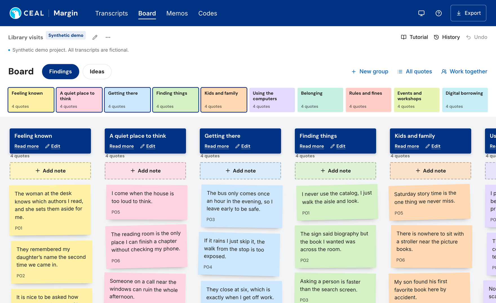
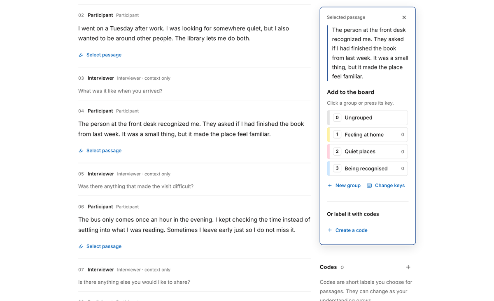
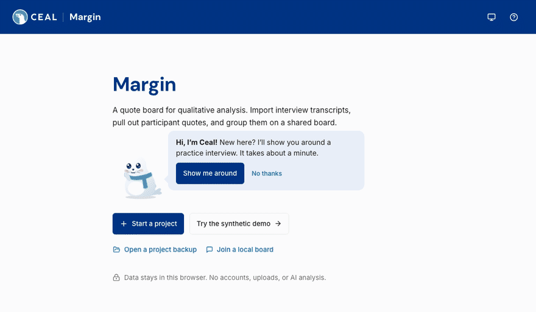

<p align="center">
  
</p>

<h1 align="center">Margin</h1>

<p align="center">
  A quote board for qualitative interview analysis.
  <br>
  <a href="https://ceal-margin.vercel.app"><b>Try the demo</b></a> · <a href="docs/HOSTING.md">Host it for your lab</a>
</p>


<p align="center"><sub>A board built from fictional interviews.</sub></p>

Margin is for reading interviews closely and sorting what participants said. Quotes keep the participant's exact words and their place in the transcript. Grouping, notes and memos stay with the researcher: there is no automated coding and no AI.

<table>
  <tr>
    <td width="50%"></td>
    <td width="50%"></td>
  </tr>
  <tr>
    <td>Select a participant's words, then click a group or press its key to file them.</td>
    <td>On a first visit, Ceal walks people through a practice interview.</td>
  </tr>
</table>

## What it does

- **Transcripts.** Import interviews as plain text and confirm who is speaking. Only participant turns can become quotes; interviewer turns stay as context. Keys 1 to 9 file into the first nine groups and 0 into Ungrouped. Further groups can be clicked, or given their own key under Change keys.
- **Board.** Each group is a column of sticky notes in its own color. Drag quotes between groups, write your own notes beside them, and use the map to move around a large board. Group names written as `Section · Name` become section tabs.
- **Memos and codes.** Write memos about what the groups add up to. A codebook, themes and a coding map are there when a project needs more structure.
- **Undo and History.** Undo steps back through your recent changes. History keeps up to 20 restore points per project.
- **Export.** A lossless project backup (JSON), and CSV files for quotes and codes, the codebook, themes, the board and quote notes.
- **Display.** Light, dark or system theme and adjustable text size. Filing, moving and the tour all work from the keyboard.

## Run it locally

Requires Node 22.12 or newer.

```sh
npm ci
npm run dev
```

Open http://127.0.0.1:5173. Projects are saved in that browser. `npm run build` followed by `npm run preview` serves the production build on http://127.0.0.1:4178.

## Working together

| | Who can open it | Where the project lives |
| --- | --- | --- |
| Live session | Browsers on the same computer | A small local server on 127.0.0.1:5180 |
| Send a copy | Whoever receives the file | A `.margin.json` backup |
| Hosted | Only the accounts you add | Supabase (Postgres with row-level security), served from Vercel |

Setup for hosted mode is in [docs/HOSTING.md](docs/HOSTING.md). Confirm that your IRB protocol allows a cloud database before uploading real transcripts.

## Privacy

Projects stay in the browser (IndexedDB) until you share them. Margin has no analytics, remote fonts or calls to AI services. This repository contains only synthetic data, and the demo runs entirely in the visitor's browser.

## Development

```sh
npm run typecheck
npm run format                                          # Prettier
npm test                                                # unit tests (Vitest)
npm run build && MARGIN_TEST_PRODUCTION=1 npm run test:browser   # browser tests (Playwright, with axe checks)
npm run test:hosted:browser                             # hosted mode against a local fixture
```

Margin is built with React, TypeScript and Vite. The data model and its integrity checks are in `src/model.ts`, the board is `src/Board.tsx`, browser storage is `src/storage.ts`, and the shared-edit protocol is `shared/operations.mjs`.

Related open-source tools: [Taguette](https://www.taguette.org/) and [QualCoder](https://qualcoder.wordpress.com/).
